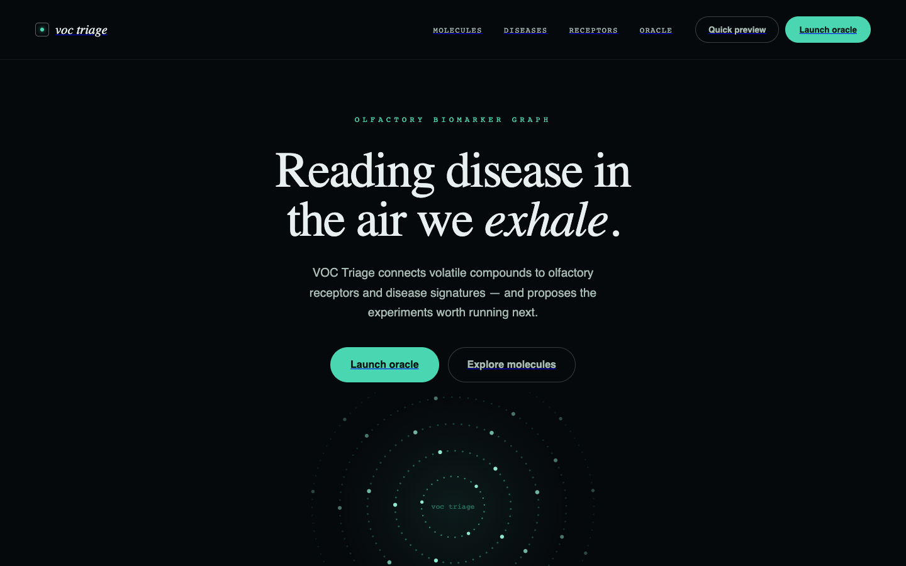

<p align="center">
  
</p>

# VOC Triage (web)

A research interface that links volatile organic compounds, olfactory receptors and diseases, built for researchers working on breath and urine volatilome biomarkers.

**Live:** <https://voc-t-design-1.vercel.app> · **Status:** hackathon prototype (UCSF QBI Hackathon 2026) · **Backend / model:** [nikhilesh-s/voc-triage](https://github.com/nikhilesh-s/voc-triage)

## What it does

- **Molecules:** browse and search compounds with formula, molecular weight, CAS and PubChem IDs, chemical class, and how often each was reported in the literature.
- **Diseases and receptors:** each has a profile page listing its linked compounds, so you can move between a molecule, the receptors it may act on, and the diseases it is associated with.
- **Oracle:** a prototype hypothesis generator that pairs a receptor with a candidate compound and drafts follow-up experiments (docking, binding assay, expression validation).

## Design

The look is a dark scientific journal: italic serif headlines, mono uppercase labels, hairline rules and one glowing teal signal. Each entity type has its own color, so a molecule, receptor or disease is recognizable anywhere on the page.

| | |
|---|---|
| Type | Newsreader (headlines) / IBM Plex Mono (labels, data) / Manrope (body) |
| Color | `#06090c` background · `#e7f0ee` text · `#4ad6b0` molecules and accent · `#8fb6ff` receptors · `#e0a458` diseases |
| Motion | Canvas "orbit" of counter-rotating particle rings in the hero (8.5–26 s periods); 0.18–0.22 s hover transitions on rows and buttons |

## How it works

A Next.js App Router site with an index page for each entity type and dynamic `[id]` detail routes. Compound and disease data are parsed client-side from a published urine volatilome dataset (supplementary tables S1 and S5) bundled in `public/`. The disease classifier itself lives in the separate [voc-triage](https://github.com/nikhilesh-s/voc-triage) FastAPI backend.

**Stack:** Next.js 16 · React 19 · TypeScript · HTML canvas · Vercel

## Run locally

```bash
npm install
npm run dev
```

Then open <http://localhost:3000>.
